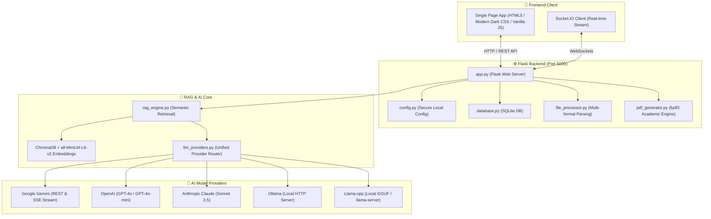

# Study Buddy — AI-Powered RAG Study Assistant

> **Study Buddy is an offline-capable, privacy-first Retrieval-Augmented Generation (RAG) desktop application that lets you study and chat with your textbooks, lecture notes, and research documents using local or cloud AI models (Google Gemini, OpenAI, Claude, Ollama, and Llama.cpp).**

---

## Table of Contents
- [Overview](#overview)
- [Key Features](#key-features)
- [Architecture](#architecture)
- [Prerequisites](#prerequisites)
- [Installation Guide](#installation-guide)
  - [Method 1: 1-Click Launch (Recommended for Windows)](#method-1-1-click-launch-recommended-for-windows)
  - [Method 2: Clean Python Virtual Environment Setup](#method-2-clean-python-virtual-environment-setup)
- [AI Provider Configuration](#ai-provider-configuration)
  - [1. Google Gemini (Recommended)](#1-google-gemini-recommended)
  - [2. OpenAI](#2-openai)
  - [3. Anthropic Claude](#3-anthropic-claude)
  - [4. Ollama (Local)](#4-ollama-local)
  - [5. Llama.cpp (Local GGUF or llama-server)](#5-llamacpp-local-gguf-or-llama-server)
- [Using the Features](#using-the-features)
  - [Interactive RAG Chatting](#interactive-rag-chatting)
  - [Study Material PDF Generator](#study-material-pdf-generator)
  - [Question Paper & Answer Key Generator](#question-paper--answer-key-generator)
- [Data Storage & Privacy](#data-storage--privacy)
- [Troubleshooting & FAQs](#troubleshooting--faqs)

---

## Overview

Study Buddy transforms any textual document (PDFs, Word documents, text notes, HTML files, codebases) into a personal, interactive AI study tutor. Your files are automatically chunked, embedded into a persistent local vector database (**ChromaDB**), and queried with high semantic precision.

---

## Key Features

- **Document Grounded Conversations**: Upload one or multiple files per conversation. Answers are synthesized strictly from your source material.
- **Multi-Format Extraction**: Ingests `.pdf`, `.docx`, `.txt`, `.html`, `.json`, `.csv`, `.md`, `.rtf`, `.epub`, `.xml`, and programming source files.
- **Real-Time Token Streaming**: Live streaming chat responses powered by WebSockets via Socket.IO.
- **Academic Study Material Generator**: Automatically produces structured, multi-page PDF study guides with cover pages, intuitive conceptual explanations, real-world examples, and code blocks.
- **Question Paper & Answer Key Generator**: Generates 10 important exam questions per topic, complete with full structured answers on dedicated answer pages.
- **Multi-Provider Support**: Choose between cloud providers (**Google Gemini**, **OpenAI**, **Anthropic Claude**) and 100% offline local inference (**Ollama**, **Llama.cpp**).
- **Persistent Local Storage**: SQLite-backed conversation history and ChromaDB vector store safely preserved on your computer.

---

## Architecture



---

## Prerequisites

- **Operating System**: Windows 10/11, macOS, or Linux (Windows optimized launcher included).
- **Python**: Python 3.10 to Python 3.13 (64-bit).
- **Browser**: Modern web browser (Chrome, Edge, Firefox, Brave, etc.).

---

## Installation Guide

### Method 1: 1-Click Launch (Recommended for Windows)

The project includes a compiled native Windows launcher and Desktop shortcut.

1. Navigate to the project directory:
   ```cmd
   cd "G:\.antigravity\Study Buddy"
   ```
2. Double-click **`StudyBuddy.exe`** (or open the **Study Buddy** shortcut on your Desktop).
3. The server will start and automatically launch your browser at `http://127.0.0.1:5000`.

---

### Method 2: Clean Python Virtual Environment Setup

*(Verified and tested inside a clean isolated environment)*

1. **Open PowerShell or Command Prompt** and navigate to the project directory:
   ```powershell
   cd "G:\.antigravity\Study Buddy"
   ```

2. **Create a virtual environment**:
   ```powershell
   python -m venv venv
   ```

3. **Activate the virtual environment**:
   - On Windows (PowerShell):
     ```powershell
     .\venv\Scripts\Activate.ps1
     ```
   - On Windows (Command Prompt):
     ```cmd
     .\venv\Scripts\activate.bat
     ```
   - On Linux/macOS:
     ```bash
     source venv/bin/activate
     ```

4. **Install required dependencies**:
   ```powershell
   pip install -r requirements.txt
   ```
   > **Note on `llama-cpp-python`**: The `requirements.txt` file automatically references the pre-built CPU wheel repository (`--extra-index-url https://abetlen.github.io/llama-cpp-python/whl/cpu`). This allows `llama-cpp-python` to install on Windows without needing Visual Studio C++ Build Tools or CMake.

5. **Start the application**:
   ```powershell
   python run.py
   ```
   Your terminal will display the startup banner and your browser will open to:
   ```text
   http://127.0.0.1:5000
   ```

---

## AI Provider Configuration

When you first open Study Buddy (or click the **Settings** gear icon in the top-right corner), select your preferred provider:

### 1. Google Gemini (Recommended)
- **Why**: Fastest responses (~0.6s) with generous free usage tiers.
- **Setup**:
  1. Get an API key from [Google AI Studio](https://aistudio.google.com/).
  2. In Study Buddy Settings, select **Google Gemini**.
  3. Paste your API key and click **Save Settings**.
- **Model Support**: Automatically defaults to `gemini-flash-lite-latest` with fallback chaining to `gemini-3.5-flash-lite` and `gemini-flash-latest` if high-demand spikes occur.

### 2. OpenAI
- **Setup**:
  1. Get an API key from [OpenAI Platform](https://platform.openai.com/api-keys).
  2. Select **OpenAI**, paste your API key (`sk-...`), and click **Save Settings**.
- **Default Model**: `gpt-4o`.

### 3. Anthropic Claude
- **Setup**:
  1. Get an API key from [Anthropic Console](https://console.anthropic.com/).
  2. Select **Anthropic Claude**, paste your API key (`sk-ant-...`), and click **Save Settings**.
- **Default Model**: `claude-3-5-sonnet-20241022`.

### 4. Ollama (Local)
- **Setup**:
  1. Install and run [Ollama](https://ollama.ai/).
  2. Pull a model (e.g., `ollama run llama3.2`).
  3. In Study Buddy Settings, select **Ollama**.
  4. Ensure Base URL is `http://localhost:11434` and enter the model name (`llama3.2` or `mistral`).

### 5. Llama.cpp (Local GGUF or llama-server)
Study Buddy supports **two flexible ways** to use llama.cpp:
- **Option A (Direct GGUF File)**:
  Enter the path to your downloaded model file:
  ```text
  C:\models\llama-3.2-3b-instruct.Q4_K_M.gguf
  ```
- **Option B (HTTP llama-server / LM Studio)**:
  Run `llama-server.exe` or LM Studio and paste the local URL:
  ```text
  http://localhost:8080
  ```

---

## Using the Features

### Interactive RAG Chatting
1. Click **New Conversation** (or the **+** button in the sidebar).
2. Drag and drop one or more study files (PDFs, Word docs, notes).
3. Click **Start Studying**.
4. Ask any questions about your documents in the chat box.

### Study Material PDF Generator
1. In any active conversation, click the **Study Material** button in the top action bar.
2. Enter specific topics you want to focus on (e.g. *"Hypothesis testing and sampling methods"*), or leave blank to summarize the entire source.
3. Choose the export folder on your PC (defaults to `~/Documents/StudyBuddy`).
4. Click **Generate Study Material**. The AI synthesizes the content using a built-in pedagogical prompt and produces a formatted PDF guide.

### Question Paper & Answer Key Generator
1. Click the **Question Paper** button in the top action bar.
2. Enter topics to test, or leave blank to cover all major concepts.
3. Click **Generate Question Paper**.
4. Study Buddy generates 10 comprehensive questions per topic, complete with an **Answer Key** section placed on dedicated pages for self-assessment.

---

## Data Storage & Privacy

All user data remains strictly on your local machine under the directory:
```text
C:\Users\<YourUsername>\.studybuddy\
```
- `config.json`: Local settings and API keys.
- `studybuddy.db`: SQLite database storing conversation metadata and chat history.
- `uploads/`: Ingested study files organized by conversation ID.
- `vector_stores/`: Local ChromaDB vector database containing document chunk embeddings.

*No study documents or embeddings are uploaded to any third-party server. Only query prompts and retrieved context snippets are communicated to your chosen AI provider.*

---

## Troubleshooting & FAQs

#### Q: How do I change my AI API key or model provider?
Click the **gear icon** (Settings) in the top-right corner of the interface at any time. Select your new provider, enter the credentials, and click **Save Settings**.

#### Q: Why did `llama-cpp-python` fail to compile on Windows?
`llama-cpp-python` requires C++ compilers if installed from source. Study Buddy solves this by using pre-built Windows CPU wheels via `--extra-index-url https://abetlen.github.io/llama-cpp-python/whl/cpu`. If you prefer not to install the Python bindings, you can simply run `llama-server.exe` on `http://localhost:8080` and enter that URL into Settings.

#### Q: Can I run Study Buddy completely offline?
**Yes.** Select either **Ollama** or **Llama.cpp** in Settings. Sentence-transformers and ChromaDB run 100% locally on your CPU/GPU without needing an internet connection.

#### Q: Where are generated PDFs saved?
PDFs are saved to your chosen destination folder (default: `Documents\StudyBuddy`). They are also cataloged in the conversation view under **Generated Files** for easy reference and redownload.
